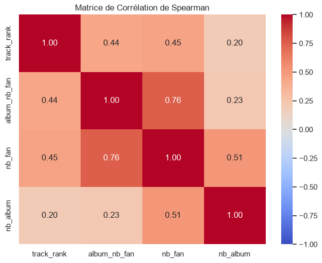
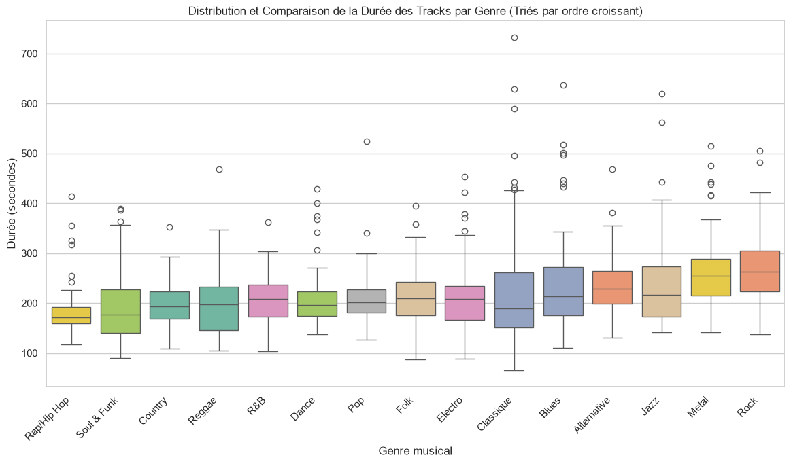
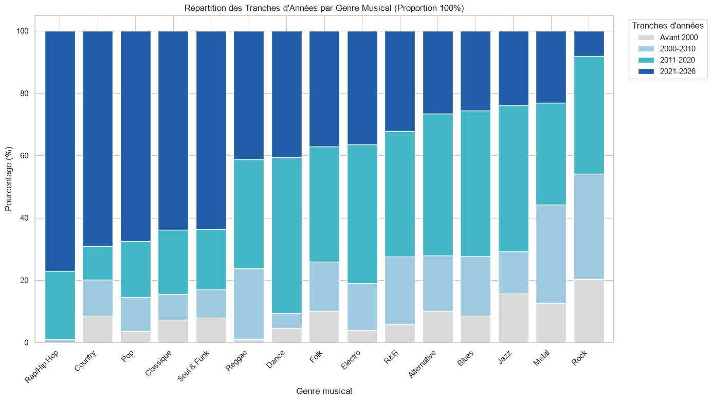

# deezer-project

Script Python qui collecte des titres via l'API publique de Deezer, puis les analyse
(popularité et nombre de fans, comparaison entre genres).

## Prérequis

- Python 3.11
- Aucune clé d'API nécessaire (endpoints publics de Deezer)

## Installation

```bash
python -m venv .venv
source .venv/bin/activate
pip install -r requirements.txt
```

## Utilisation

```bash
python main.py
```

Le script crée un dossier `data/` contenant `genres.csv` et `tracks.csv`, ainsi qu'un dossier `figures/` regroupant tous les graphiques d'analyse.
La collecte prend quelques minutes, car une pause est faite entre les appels pour respecter le quota de l'API (50 appels / 5 s).

Elle est **reprenable** : si elle est interrompue, relancer la commande reprend où elle s'était arrêtée, sans redemander les titres déjà collectés. Pour repartir de zéro, supprimer le dossier `data/`.

## Structure du projet

```text
.
├── main.py             # point d'entrée
├── config.py           # constantes (URL, chemins, colonnes, genres exclus...)
├── data_collector.py   # collecte : genres, classements, détails album et artiste
├── data_analyser.py    # analyse
├── utils.py            # outils : appels API, lecture/écriture CSV, cache
├── requirements.txt
├── data/               # CSV générés (genres.csv, tracks.csv)
└── figures/            # Graphiques et visualisations générés
```

## Partie 1 : stratégie de collecte

Les titres sont collectés via les **classements par genre** de l'API Deezer
(`/chart/{genre_id}/tracks`).

1. **Choix des genres** : on récupère la liste des genres (`/genre`), puis on retire
   ceux qui ne sont pas purement musicaux ou trop régionaux (liste `EXCLUDE_GENRES`
   dans `config.py`). Il reste 15 genres internationaux comparables (Pop, Rock,
   Rap/Hip-Hop, Electro, Jazz...).
2. **Volume** : pour chaque genre, on prend les 100 premiers titres du classement,
   soit jusqu'à 1 500 lignes. Un titre présent dans plusieurs classements est conservé
   une fois par genre ; les titres uniques se comptent avec `track_id`.
3. **Équilibre entre genres** : chaque genre apporte environ le même nombre de titres.
4. **Enrichissement** : chaque titre est complété par deux appels, `/album/{id}`
   (date de sortie, label, durée, fans, type de disque) et `/artist/{id}`
   (nombre d'albums et de fans). Ces infos sont mises en cache : un titre déjà connu
   n'est jamais redemandé.
5. **Années de sortie** : les classements mêlent succès récents et titres plus anciens.
   La répartition par année n'est pas imposée à la collecte, elle est examinée
   lors de l'analyse.

### Données collectées

| Niveau  | Colonnes |
|---------|----------|
| Titre   | `track_id`, `track_title`, `track_duration`, `track_bpm`, `track_release_date`, `track_rank` |
| Album   | `album_title`, `album_release_date`, `label`, `album_duration`, `album_nb_fan`, `record_type` |
| Artiste | `artist_name`, `nb_album`, `nb_fan` |
| Genre   | `genre` |

### Limites

- Les classements reflètent la popularité actuelle : l'échantillon est biaisé vers les
  titres populaires et récents.
- Le `genre` d'un titre est celui du classement dans lequel il apparaît.
- Les valeurs manquantes sont remplacées par `0` ou `Inconnu`. Pour le BPM et le rang,
  `0` signifie « non renseigné » et sera exclu des calculs.
- Les rangs et nombres de fans évoluent dans le temps : les données correspondent à
  la date de collecte.

## Partie 2 : analyse

Cette partie présente les résultats statistiques et visuels tirés de l'échantillon collecté.

### 1. Lien entre popularité, rang et fanbase
- **Matrice de corrélation** : L'analyse des liens entre les variables numériques (via la matrice de Spearman) montre une corrélation modérée entre le nombre de fans de l'artiste et le rang des pistes.
- **ANOVA sur la durée** : Un test statistique a été réalisé pour comparer la durée des morceaux selon les genres. Le résultat confirme des différences hautement significatives ($F = 11,29$, p-value = $7,80 \times 10^{-25}$).



### 2. Comparaison de la durée par genre
- Étant donné que le BPM n'est pas toujours renseigné (beaucoup de valeurs à 0), cette métrique a été écartée au profit de la **durée**.
- Tous les genres étant représentés de manière équitable (top 100 récupéré par genre), les boîtes à moustaches triées par ordre croissant de durée montrent clairement que certains genres privilégient les formats courts (comme le Rap/Hip-Hop) tandis que d'autres acceptent des formats plus longs (comme le Rock).



### 3. Les musiques populaires sont-elles plutôt récentes ou anciennes selon le genre ?
- **Question posée** : *Est-ce que selon le genre musical, les gens écoutent plutôt des tracks anciens ou récents dans les charts ?*
- En analysant la proportion des tranches d'années par genre (grâce au graphique en barres empilées), on observe de vraies disparités : certains genres comme le Rap/Hip-Hop sont dominés par les sorties très récentes (2021-2026), tandis que d'autres genres (comme le Rock ou le Jazz) intègrent une part beaucoup plus importante de classiques plus anciens dans leurs classements.

